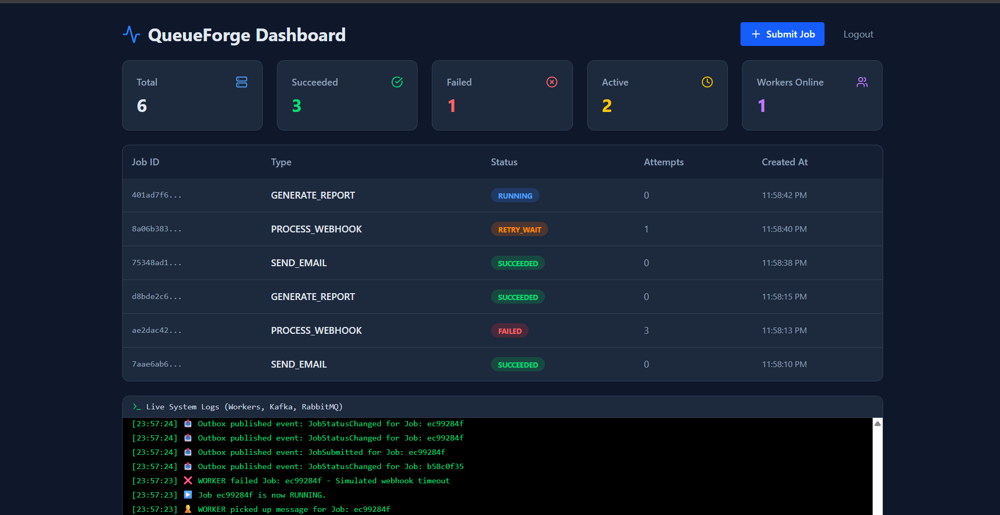
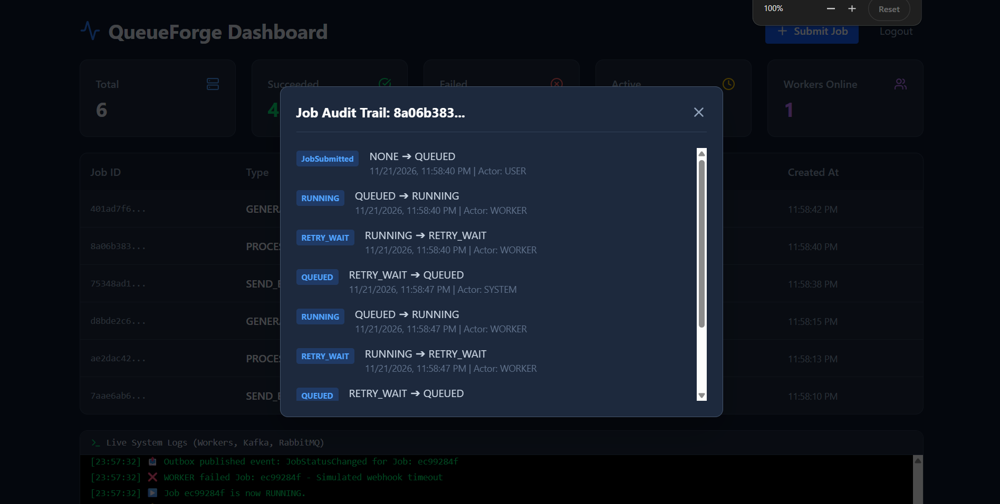
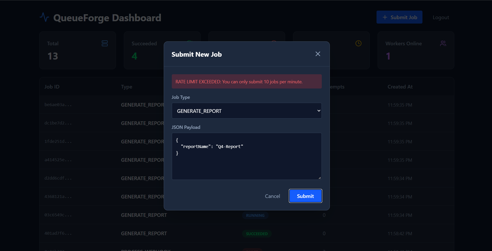
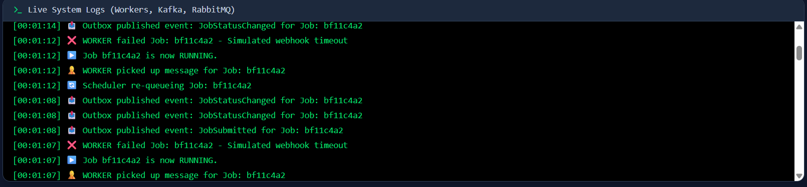
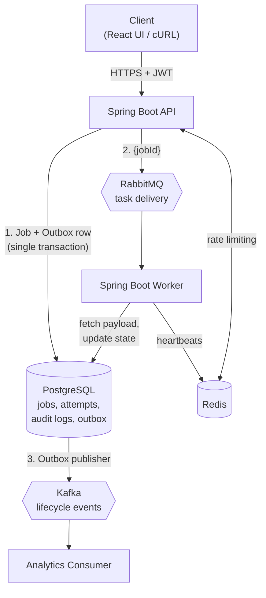

<div align="center">


# ⚙️ QueueForge

**A distributed background-job orchestration platform for developers.**

[](https://youtu.be/9x3PAFjVdcU)


</div>

---

## 📸 Screenshots

### 1. Mission Control Dashboard
Real-time metrics, job statuses, Redis worker heartbeats, and the live Kafka/RabbitMQ log stream.


<div align="center">
  
  
</div>
<br/>
<div align="center">
  
</div>

---

## 📖 Overview

QueueForge separates job **submission** from job **execution**. Applications submit jobs through an authenticated API, state is persisted in PostgreSQL, and a separate Worker runtime executes them asynchronously. It handles retries, failures, delayed execution, and real-time event streaming.

It is built to demonstrate real-world distributed systems engineering:

| Concept | Where it shows up |
| :--- | :--- |
| **At-least-once delivery** | Manual RabbitMQ acknowledgments |
| **Idempotency** | `Idempotency-Key` header on job submission |
| **Optimistic locking** | `@Version` column on the `jobs` table |
| **Retries with exponential backoff** | Per-job retry policy |
| **Transactional Outbox** | Reliable PostgreSQL → Kafka event publishing |

## 📑 Table of Contents

- [Architecture](#-architecture)
- [Core Components](#-core-components)
- [Key Engineering Decisions](#-key-engineering-decisions)
- [Tech Stack](#-tech-stack)
- [Getting Started](#-getting-started)
- [API Examples](#-api-examples)
- [Known Limitations](#-known-limitations--tradeoffs)
- [Roadmap](#-roadmap)

## 🏗️ Architecture



<details>
<summary>Plain-text version of the diagram</summary>

```text
[ Client (React UI / cURL) ]
            |
            v
[ Spring Boot API ]  (JWT auth, rate limiting via Redis)
    |        |        |
   (1)      (2)      (3)
    v        v        v
[PostgreSQL] [RabbitMQ] [Kafka]
 Jobs,        Task       Lifecycle
 Outbox       delivery   events
                |
                v
        [ Spring Boot Worker ]
         Consumes message, runs handler,
         updates state
```

</details>

## 🧩 Core Components

| Component | Role |
| :--- | :--- |
| **PostgreSQL** | Durable source of truth. Stores jobs, attempt history, audit logs, and the transactional outbox. |
| **RabbitMQ** | Delivers lightweight messages (`{"jobId": "123"}`) from the API to the Worker. The Worker always fetches the full payload from PostgreSQL to avoid stale data. |
| **Kafka** | Carries lifecycle events (e.g. `JobSubmitted`, `JobSucceeded`) asynchronously, enabling high-speed analytics without touching the database. |
| **Redis** | API rate limiting and Worker heartbeats. |
| **State Machine** | Every job transition (e.g. `QUEUED` → `RUNNING` → `SUCCEEDED`) goes through a centralized domain service that enforces strict rules and writes audit logs. |

## 🧠 Key Engineering Decisions

### 1. Transactional Outbox Pattern
To guarantee no events are lost if Kafka goes down, state changes never publish directly to Kafka. Instead, an `OutboxEvent` row is saved in the **same PostgreSQL transaction** as the job update. A background publisher then reads the outbox and sends events to Kafka.

### 2. Idempotency
`POST /api/v1/jobs` accepts an `Idempotency-Key` header. If a client retries with the same key and payload, the server returns the existing job instead of creating a duplicate.

### 3. Optimistic Locking
The `jobs` table has a `@Version` column. If two workers somehow try to process the same job concurrently, the database rejects the second update.

### 4. At-Least-Once Delivery
RabbitMQ uses manual acknowledgments. The worker ACKs a message **only after** the database transaction commits successfully. If the worker crashes mid-job, RabbitMQ redelivers it.

## 🛠️ Tech Stack

| Layer | Technology |
| :--- | :--- |
| **Backend** | Java 21, Spring Boot 3.5.7 |
| **Security** | Spring Security, JWT (JJWT), BCrypt |
| **Database** | PostgreSQL 17, Flyway, Hibernate |
| **Messaging** | RabbitMQ 4.x, Apache Kafka 4.x |
| **Caching / Speed** | Redis 7.x |
| **Frontend** | React 18, TypeScript, Vite, Tailwind CSS |
| **Infrastructure** | Docker Compose |

## 🚀 Getting Started

### Prerequisites

- Java 21+
- Maven 3.9+
- Node.js 22+
- Docker Desktop (make sure it is running)

### 1. Start the infrastructure

Starts PostgreSQL, Redis, RabbitMQ, and Kafka.

```bash
cd infra
docker compose up -d
```

### 2. Start the API & Worker

From the project root, in a new terminal:

```bash
./mvnw spring-boot:run
```

> The API starts on <http://localhost:8080> and applies Flyway migrations automatically.
> On Windows, use `mvnw.cmd spring-boot:run`.

### 3. Start the dashboard

In another terminal:

```bash
cd frontend
npm install
npm run dev
```

> The dashboard starts on <http://localhost:5173>.

### 4. Log in

Open <http://localhost:5173> and use the seeded local credentials:

| Field | Value |
| :--- | :--- |
| **Email** | `admin@queueforge.local` |
| **Password** | `admin123` |

> ⚠️ These credentials are for local development only.

## 📡 API Examples

### Submit a job

```bash
curl -X POST http://localhost:8080/api/v1/jobs \
  -H "Authorization: Bearer <YOUR_TOKEN>" \
  -H "Idempotency-Key: unique-key-123" \
  -H "Content-Type: application/json" \
  -d '{
    "type": "GENERATE_REPORT",
    "payload": {"reportName": "Q4-Earnings", "format": "csv"},
    "retryPolicy": {"maxAttempts": 3}
  }'
```

### Fetch all jobs

```bash
curl -X GET http://localhost:8080/api/v1/jobs \
  -H "Authorization: Bearer <YOUR_TOKEN>"
```

## ⚠️ Known Limitations & Tradeoffs

- **Exactly-once execution is not guaranteed.** A worker may complete an external side effect (like sending an email) and crash before committing the success state. Redelivery may then run the handler again, so QueueForge relies on **idempotent handlers**.
- **Database and broker atomicity.** The outbox publisher can crash after Kafka accepts an event but before the outbox row is marked `PUBLISHED`, producing duplicate Kafka events. The `AnalyticsConsumer` is designed to handle duplicates safely.
- **Local timezones.** Local Windows environments default to the legacy `Asia/Calcutta` timezone, so the PostgreSQL connection string explicitly overrides it with `Asia/Kolkata` to prevent connection failures.

## 🔮 Roadmap

- [ ] Recurring / cron jobs
- [ ] Priority queues in RabbitMQ
- [ ] Testcontainers-based integration tests
- [ ] Prometheus + Grafana metrics dashboard